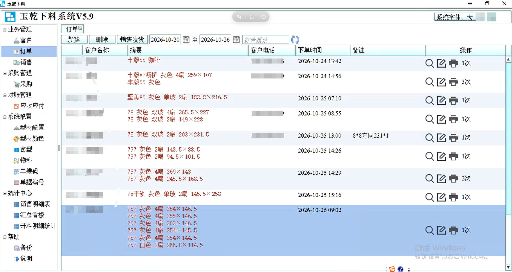
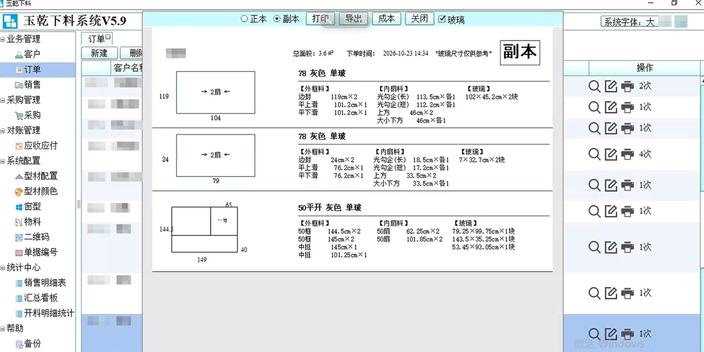
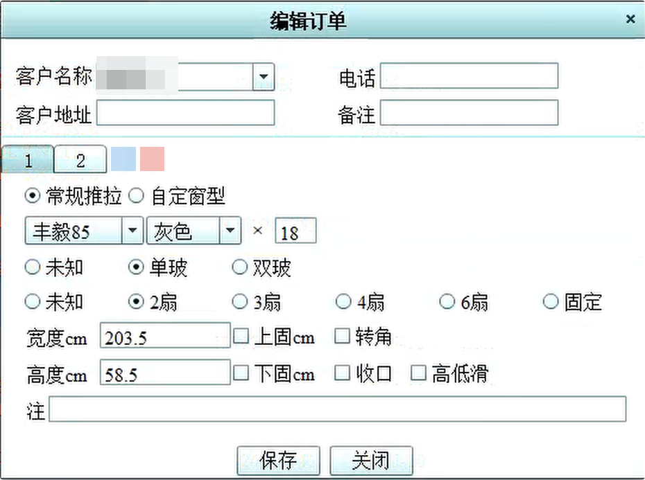
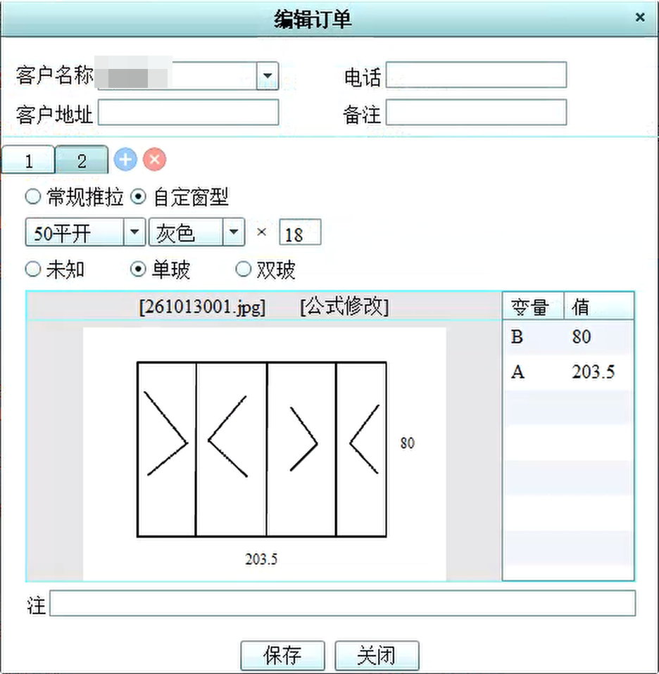
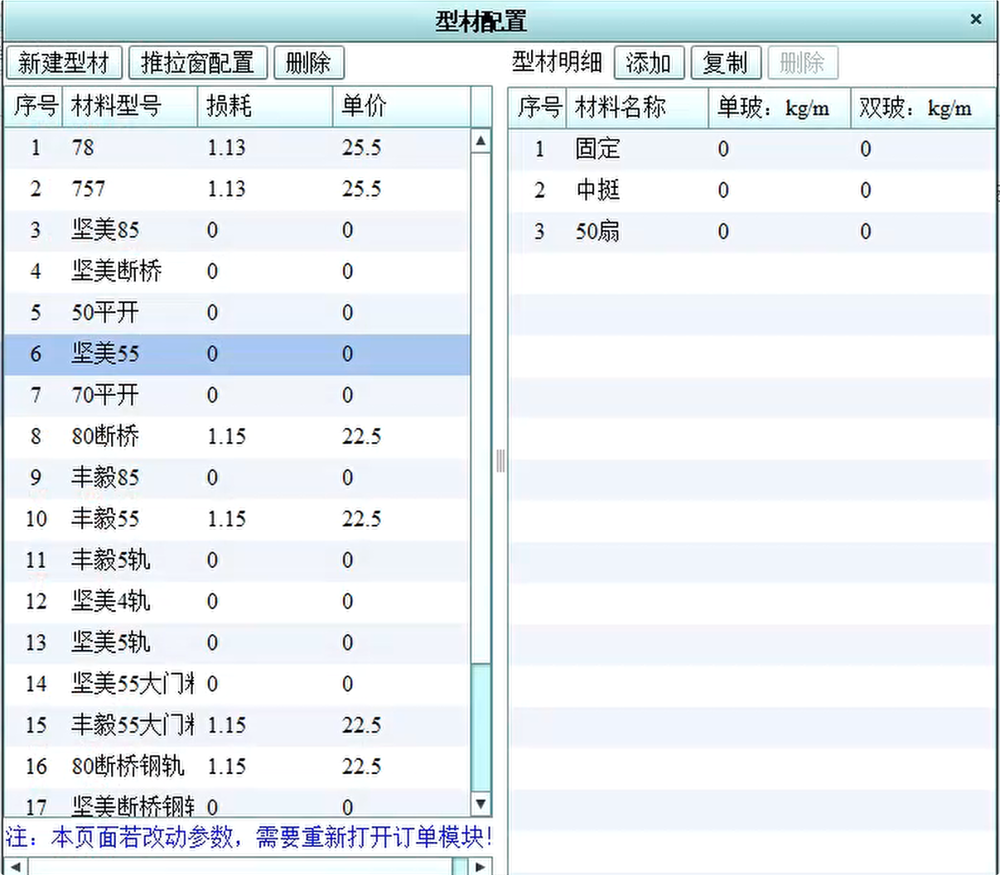
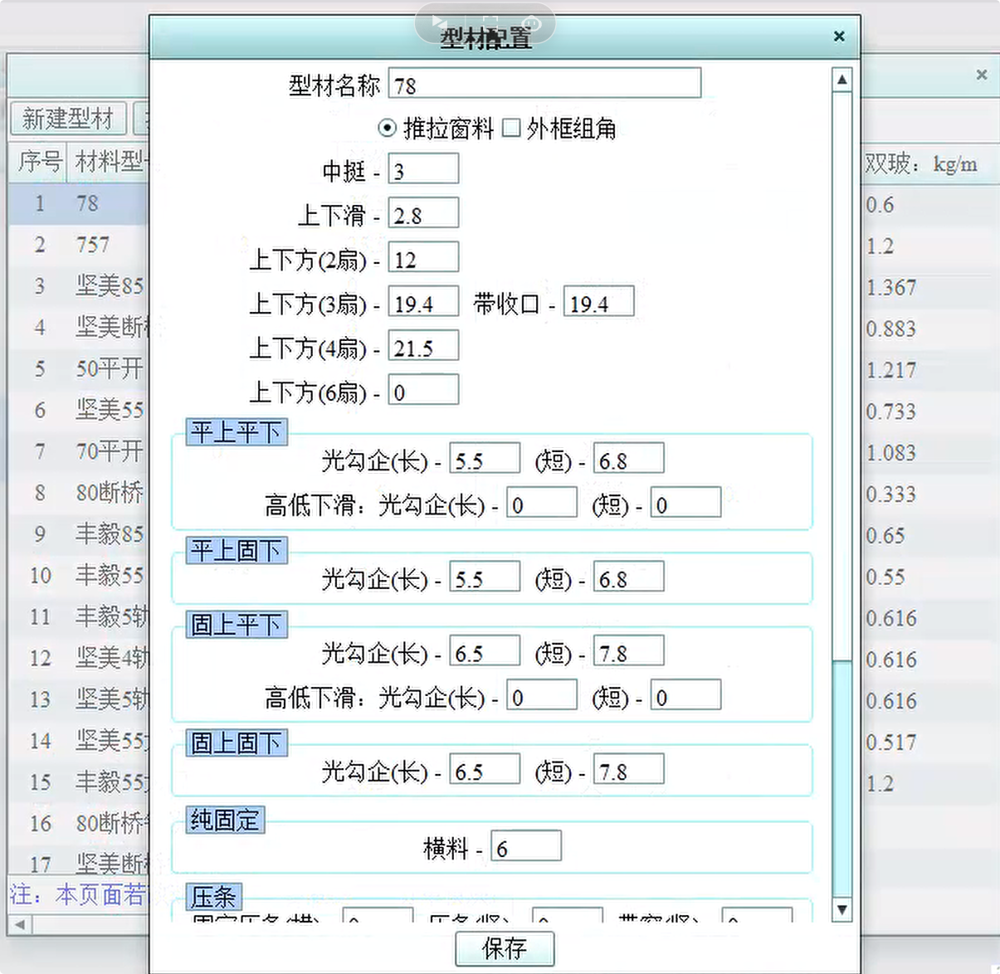
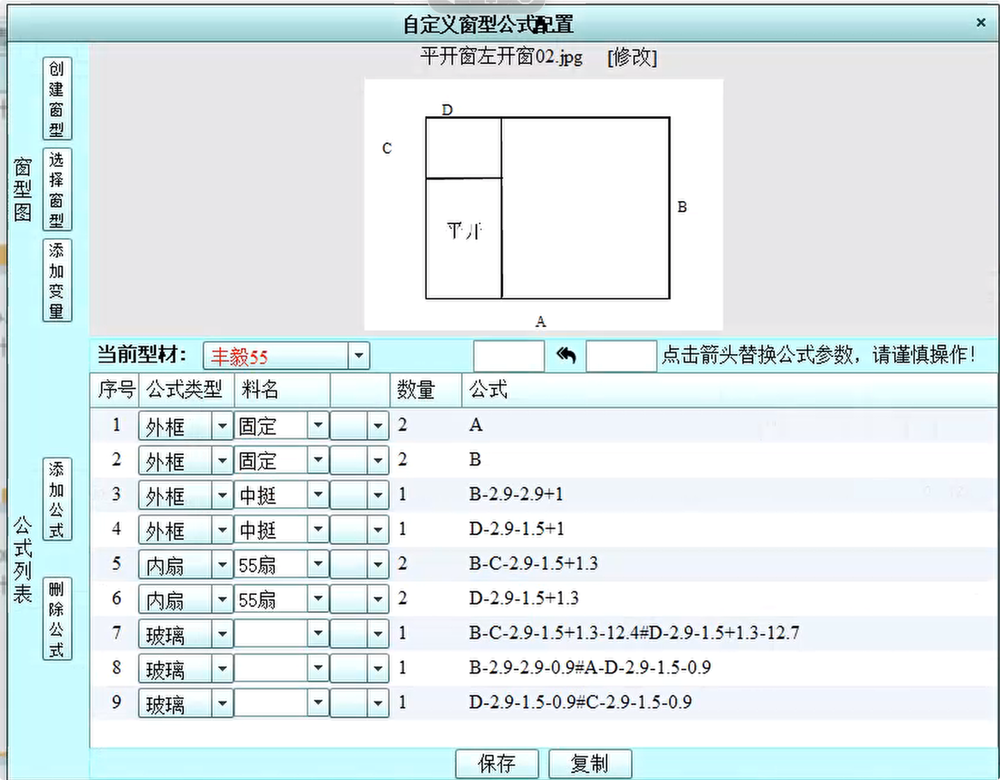
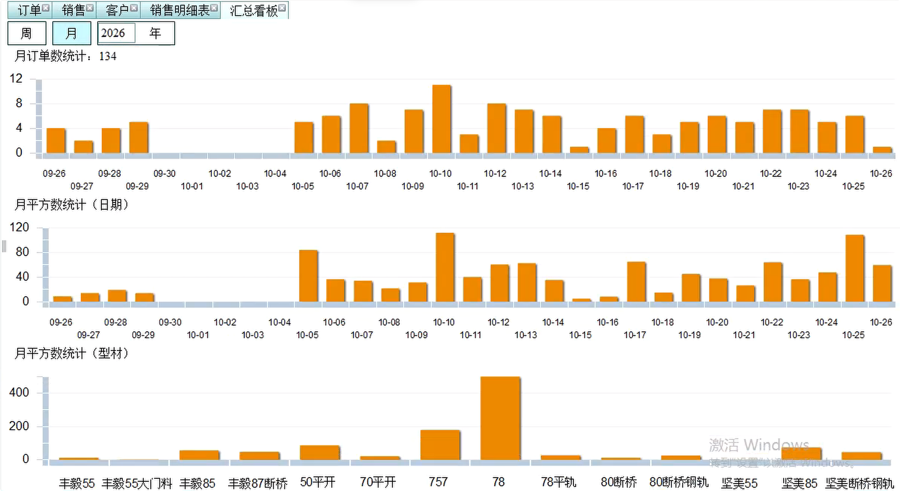
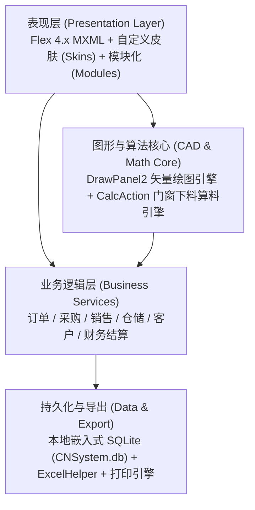

# 玉乾下料管理系统 (CutCalcSystem / HelpSystem)

<p align="center">
  <strong>面向断桥铝门窗加工与工程定制的数字化下料计算与进销存管理系统</strong>
</p>

<p align="center">
  
  
  
  
  
</p>

---

## 📖 项目简介

**玉乾下料管理系统**（英文标识：`CutCalcSystem`，代码仓库名：`helpsystem`）是一款专为门窗制造厂、型材加工车间与定制门窗工程门店研发的专业级生产与进销存协同管理系统。

系统基于 **Adobe AIR** 原生桌面运行环境与 **Apache Flex (ActionScript 3.0 / MXML)** 构建，结合嵌入式 **SQLite** 本地数据引擎，将复杂的**断桥铝型材下料算法推导**、**门窗立面参数化绘制**与**企业进销存业务闭环**（订单、采购、仓储、销售、发票、财务统计）深度融合，实现“一键画窗、精密算料、自动出单、全流程追溯”的一体化加工管理。

---

## 📸 系统界面实览 (System Screenshots)

### 1. 业务工作台与下料单输出

| 系统主工作台 (订单管理列表) | 车间下料单打印与导出预览 |
| :---: | :---: |
|  |  |

### 2. 参数化订单录入 (常规推拉 & 自定义窗型)

| 常规推拉窗快速录入 | 自定义窗型参数化录入 |
| :---: | :---: |
|  |  |

### 3. 型材库与算料公式推导配置

| 型材规格库与单价损耗维护 | 推拉窗料精密扣减公式配置 |
| :---: | :---: |
|  |  |

### 4. 异形窗型公式建模与经营看板

| 异形窗型公式与变量联动配置 | 销售与生产统计看板 (订单/平方数走势) |
| :---: | :---: |
|  |  |

---

## 🚀 核心架构与技术栈



### 技术选型矩阵

| 分层维度 | 技术实现 / 组件 | 说明 |
| :--- | :--- | :--- |
| **桌面运行时** | Adobe AIR 3.1+ (ExtendedDesktop) | 纯本地免安装中间件运行，高响应度与系统硬件交互 |
| **前端应用框架** | Apache Flex 4.x (MXML + AS3) | 富客户端组件库、自定义 DataGrid 头皮肤与主题换肤 |
| **门窗绘图引擎** | 矢量贝塞尔曲线与多边形绘制 (`draw/`) | 支持弧形窗、转角窗、光勾企、封盖、内外扇可视化交互排版 |
| **算料数学引擎** | 参数化下料推导 (`calc/CalcAction.as`) | 毫米级下料尺寸计算、断桥型材公式推导、损耗扣减与拼角余量 |
| **嵌入式数据库** | SQLite 3 (`CNSystem.db`) | 零配置单机运行、支持离线数据持久化与自动事务安全 |
| **打印与报表** | 原生 Flex PrintJob (`print/sell/`) + ExcelHelper | 车间下料单、客户销售出库单、送货联直打与报表导出 |

---

## 🛠️ 功能模块全景

系统包含 10 大核心功能模块，全面覆盖门窗加工企业的日常生产运营：

```
src/module/
├── HomeModule.mxml            # 系统工作台首页：快捷导航、数据汇总与版本状态
├── OrderModule.mxml           # 订单管理：定制订单录入、窗型关联、明细分拆与排产
├── OrderDetailReport.mxml     # 订单明细报表：工料清单、窗型尺寸及加工进度汇总
├── SellModule.mxml            # 销售管理：出库发货开单、成品交接与客户对账
├── SellReportModule.mxml      # 销售报表：销售业绩统计、区域/产品走势与毛利核算
├── PurchaseModule.mxml        # 采购管理：原铝型材、五金配件、密封胶条与玻璃采购入库
├── MaterialModule.mxml        # 物料与型材库：型材规格型号、米重、单价与动态库存盘点
├── CustomerModule.mxml        # 客户档案：工程客户信息、联系人、历史交易与授信管理
├── InvocieModule.mxml         # 发票开具与税务：开票申请、发票登记与核销管理
└── AccountStatModule.mxml     # 财务对账：收支台账、应收应付账款与资金流统计
```

---

## 📐 门窗参数化绘图与下料计算特性

1. **窗型参数化快速建模**：
   - 支持平开窗、推拉窗、上悬/下悬、固定玻璃、弧形拼接窗等常规与异形窗立面建模；
   - 交互式拖拽设定中挺、压线、扇料与分格尺寸。
2. **断桥铝型材精密下料扣减**：
   - 针对 70/80 系列等各类断桥结构，精准适配光勾企长短差异、封盖匹配长短尺寸；
   - 自动扣除转角配件、角码厚度、密封条卡槽缝隙与玻璃搭接量；
   - 自动生成车间下料切割工单（包含型材代号、切割长度、角度 45°/90°、数量）。
3. **高精单据打印输出**：
   - 打印模板适配针式打印机连续出纸与 A4 激光打印机；
   - 自动将数值金额转化为合规汉字大写（`RMBHelper.as`），防止财务造假。

---

## 💻 目录结构规范

```text
helpsystem/
├── .actionScriptProperties    # Flash Builder / AIR 工程配置文件
├── .flexProperties            # Flex 编译器参数配置
├── .project                   # Eclipse / Flash Builder 项目元数据
├── helpSystem.iml             # IntelliJ IDEA 工程模型
├── CNSystem.db                # SQLite 核心业务数据库
├── README.txt                 # 版本迭代发布履历
├── 统计sql.txt                # 核心统计与报表 SQL 查询脚本
├── bin-debug/                 # 本地构建输出与 SWF 文件
├── docs/                      # 文档与系统截图资源
│   └── images/                # 系统界面高清实览图
├── libs/                      # 外部引用类库与 SWC 扩展包
└── src/
    ├── helpSystem-app.xml     # Adobe AIR 应用程序描述符清单（版本、权限、窗口配置）
    ├── helpSystem.mxml        # 应用程序主入口主舞台
    ├── calc/                  # 算料推导与数学公式核心逻辑
    ├── common/                # 基础通用工具集（大写转换、Excel辅助、加密、日期）
    ├── datasource/            # SQLite 数据库底层连接器与 SQL 执行器
    ├── draw/                  # 门窗矢量绘图面板与几何曲线渲染引擎
    ├── entity/                # 领域实体模型（POJO / DTO）
    ├── module/                # 业务子模块（订单、销售、采购、仓储、财务等）
    ├── print/                 # 报表打印模板及排版组件
    ├── skins/                 # UI 定制皮肤、色彩选择器与树形下拉控件
    └── util/                  # 图像与组件级辅助工具
```

---

## 🔧 开发与构建部署

### 环境要求

- **IDE**：Adobe Flash Builder 4.6+ 或 IntelliJ IDEA（安装 Flash/Flex Support 插件）
- **SDK**：Apache Flex SDK 4.6.0+ 配套 Adobe AIR SDK 3.1+
- **操作系统**：Windows 7 / 10 / 11

### 本地编译运行

1. 在 IDE 中导入现有项目目录 `helpsystem`。
2. 确保项目构建路径中已绑定 Flex 4.x SDK 及 AIR 桌面运行时环境。
3. 检查数据库路径配置：系统启动时默认加载工程根目录下的 `CNSystem.db`。
4. 运行主入口文件 `src/helpSystem.mxml` 进行本地调试与构建输出。
